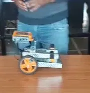

# NeuroRide 🧠♿

**An eye- and brain-controlled smart wheelchair with health monitoring and automatic medical emergency response.**

Built for the **Avishkaar Makeathon 2026** — theme *Mayday: The Final Call*, Health Guard track.
By **Bhuvan Gowda BC**, Bengaluru.

<p align="center">
  
</p>

---

## The problem

People with paralysis, ALS, stroke or spinal injuries often cannot use a joystick-controlled wheelchair. In an emergency or a flood, they are the most likely to be stranded, and help that arrives late can cost a life.

## The solution

NeuroRide lets the user drive using only **eye movements, blinks and a jaw clench**, read through biosignals. It watches their health and calls for help on its own.

| Signal | Action |
| --- | --- |
| Double blink | Start / stop |
| Look left / right (EOG) | Turn left / right |
| Jaw clench (EMG) | Emergency stop |
| Obstacle < 20 cm, tilt, or water detected | Forced stop (overrides everything) |

## Features

- **Hands-free control** — EOG/EMG via the BioAmp EXG Pill, with per-user calibration to reduce false triggers
- **Safety layer** — ultrasonic obstacle stop and tilt cut-off override every command
- **Health Guard** — heart rate, SpO2 and fall detection
- **Medical Emergency Response**
  - Detects emergencies automatically (abnormal vitals, fall, no response to an "Are you OK? Blink twice" check)
  - Alerts family with live GPS and prepares a one-tap ambulance call
  - Sends the doctor an auto report: last 30 minutes of vitals + Medical ID
  - Step-by-step first-aid guidance until help arrives
- **Flood mode** — water sensor locks movement and alerts rescuers
- **Companion app** — prototype UI for control, health and SOS

## How it works

```
Electrodes → BioAmp EXG Pill (3.3 V) → ESP32-WROOM-32 ADC
                                      ├─ filter + detect glance / blink / clench → command
                                      ├─ BLE ↔ companion app
                                      ├─ MAX30102, MPU6050, HC-SR04, water sensor
                                      └─ motor driver (or Maker Board 2.0) → Avishkaar motors
```

## Hardware

| Part | Role |
| --- | --- |
| Upside Down Labs DIY Neuroscience Kit – Basic | BioAmp EXG Pill, electrodes, bands |
| ESP32-WROOM-32 | Main controller, Bluetooth |
| Avishkaar Pro kit | Wheelchair chassis and motors |
| TB6612FNG motor driver | Drives the motors |
| MAX30102, MPU6050, HC-SR04, water sensor | Health and safety sensing |

Full list with prices: [Materials List](docs/NeuroRide_Materials_List.pdf)

## Documents

- 📄 [Project Documentation](docs/NeuroRide_Project_Documentation.pdf)
- 🛠️ [Step-by-step Build Plan](docs/NeuroRide_Build_Plan.pdf) — stages, wiring tables, tests
- 🧾 [Materials List](docs/NeuroRide_Materials_List.pdf)

## Build progress

- [ ] Stage 0 — ESP32 basics, chassis shape
- [ ] Stage 1 — Blink, glance and clench detected (8/10 accuracy)
- [ ] Stage 2 — Motors driven from the ESP32
- [ ] Stage 3 — Eye signals drive the chair, obstacle stop
- [ ] Stage 4 — Health Guard, emergency response, flood mode
- [ ] Stage 5 — Demo video, PPT, submission (by 30 Nov 2026)

## Repository layout

```
docs/       Project documents (PDF)
firmware/   ESP32 code (coming soon)
images/     Build photos
```

## Safety note

This is a student prototype, not a medical device. Emergency calls are simulated during testing, and first-aid guidance supports trained help, never replaces it.

## Acknowledgements

- [Upside Down Labs](https://upsidedownlabs.tech/) for the BioAmp hardware and Chords software
- [Avishkaar](https://community.avishkaar.cc/) for the Makeathon and the robotics kit
